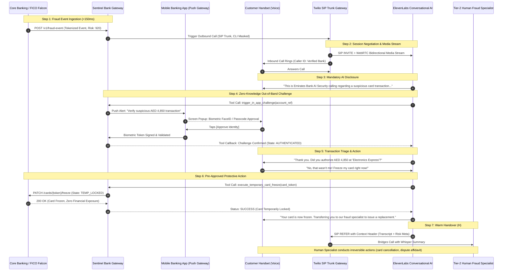

# PROJECT SENTINEL · PRODUCTION BLUEPRINT & SYSTEM ARCHITECTURE
## REAL-TIME FRAUD INTERVENTION VOICE AGENT FOR REGULATED FINANCIAL WORKFLOWS
**Target Stack: ElevenLabs Conversational AI, Twilio SIP/WebRTC, Core Banking Event Bus**

---

## 1. EXECUTIVE SUMMARY & THREAT MODEL

### 1.1 The UAE Financial Ecosystem Context
In the United Arab Emirates, retail banking has transitioned to instant account-to-account settlements powered by **Aani** (Al Etihad Payments) and instant card rails. Transactions settle irreversibly in **under 15 seconds**.

Simultaneously, fraud vectors have evolved drastically:
1. **SMS OTP Bypass & SIM Swapping**: Attackers leverage social engineering to intercept SMS OTPs or drain funds through compromised cards.
2. **Vishing Sensitivity & Paranoia**: Because phone scams are prevalent in the GCC, legitimate outbound fraud calls from banks are treated with extreme suspicion; customers frequently disconnect when asked to confirm details.
3. **Multilingual Expatriate Demographics**: Over 88% of the UAE population comprises expatriates. When fraud strikes, an English-only or classical Arabic IVR causes cognitive hesitation, language barriers, and immediate drop-off, allowing unauthorized transactions to finalize.

### 1.2 The Architectural Objective
**Project Sentinel** builds a millisecond-latency, multilingual, zero-knowledge voice intervention agent. The moment a transaction risk score exceeds the institutional threshold ($\ge 850$ on FICO Falcon), Sentinel initiates a high-priority outbound call in the customer’s preferred dialect, verifies identity without demanding voice passwords or OTPs, executes an immediate, reversible card freeze via scoped API tools, and seamlessly warm-transfers to a human investigator for irreversible account remediation.

---

## 2. HIGH-LEVEL SYSTEM TOPOLOGY



---

## 3. ZONE-BY-ZONE ARCHITECTURAL SPECIFICATION

```
┌────────────────────────────────────────────────────────────────────────────────────────┐
│                              ZONE 1: CALLER & CHANNEL                                  │
│                                                                                        │
│   ┌───────────────────────────┐                ┌──────────────────────────────────┐   │
│   │  Customer Handset (PSTN)  │<── G.711 / ───>│   Twilio Voice / SIP Trunk       │   │
│   │   (Voice / UAE Telco)     │     SRTP       │   - Geo-local UAE Calling Line   │   │
│   └───────────────────────────┘                │   - Early media handling         │   │
│                 ▲                              │   - SIP REFER transfer engine    │   │
│                 │ (Out-of-band In-App Push)    └──────────────────────────────────┘   │
│                 ▼                                               ▲                      │
│   ┌───────────────────────────┐                                 │ TLS 1.3 / SRTP       │
│   │   Mobile Banking App      │                                 │ WebSocket Stream     │
│   │   (iOS / Android PKI)     │                                 ▼                      │
└─────────────────┼───────────────────────────────────────────────┼──────────────────────┘
                  │                                               │
┌─────────────────┼───────────────────────────────────────────────┼──────────────────────┐
│                 │                ZONE 2: ELEVENLABS PLATFORM    │                      │
│                 │                                               ▼                      │
│                 │              ┌──────────────────────────────────────────────────┐    │
│                 │              │      ElevenLabs Conversational AI Agent          │    │
│                 │              │                                                  │    │
│                 │              │  ┌────────────────────┐  ┌────────────────────┐  │    │
│                 │              │  │   Scribe v2 STT    │  │   Eleven v3 TTS    │  │    │
│                 │              │  │  (Keyterm Biasing) │  │  (Emirati / Turbo) │  │    │
│                 │              │  └────────────────────┘  └────────────────────┘  │    │
│                 │              │            │                        ▲            │    │
│                 │              │            ▼                        │            │    │
│                 │              │  ┌────────────────────────────────────────────┐  │    │
│                 │              │  │     Agent Workflows (Deterministic FSM)    │  │    │
│                 │              │  └────────────────────────────────────────────┘  │    │
│                 │              │            │                        │            │    │
│                 │              │            ▼                        ▼            │    │
│                 │              │  ┌─────────────────┐        ┌─────────────────┐  │    │
│                 │              │  │  Knowledge Base │        │ Webhook Client  │  │    │
│                 │              │  │ (CBUAE Scripts) │        │  Tools (Scoped) │  │    │
│                 │              │  └─────────────────┘        └─────────────────┘  │    │
│                 │              └─────────────────────────────────────┼────────────┘    │
│                 │                                                    │                 │
└─────────────────┼────────────────────────────────────────────────────┼─────────────────┘
                  │                                                    │
                  │  HTTPS (mTLS)                                      │ HTTPS (mTLS)
                  │  Signed Nonce                                      │ Scoped Execution
                  ▼                                                    ▼
┌────────────────────────────────────────────────────────────────────────────────────────┐
│                        ZONE 3: INSTITUTION BANKING ENCLAVE                             │
│                                                                                        │
│   ┌────────────────────────────────────────────────────────────────────────────────┐   │
│   │  • [PII Boundary] Sentinel Secure API Gateway (FastAPI / Envoy Proxy)          │   │
│   │    - SHA-256 HMAC Authentication                                               │   │
│   │    - Rate Limiting & Circuit Breaking                                          │   │
│   │    - Zero-Knowledge Token Mapping (No PAN/PII sent to Voice Layer)             │   │
│   └───────────────┬───────────────────────────────┬───────────────────────────┬────┘   │
│                   │                               │                           │        │
│                   ▼                               ▼                           ▼        │
│   ┌───────────────────────────────┐ ┌───────────────────────────┐ ┌────────────────┐   │
│   │ Push Challenge Auth Engine    │ │ Scoped Card Freeze Engine │ │ Tier-2 Fraud   │   │
│   │ - Apple APNs / Google FCM     │ │ - Idempotent REST API     │ │ Human Queue    │   │
│   │ - Public Key Signature Verify │ │ - Temenos T24 / Way4 Core │ │ (Genesys Cloud)│   │
│   └───────────────────────────────┘ └───────────────────────────┘ └────────────────┘   │
│                   │                               │                           │        │
│                   └───────────────────────┬───────┴───────────────────────────┘        │
│                                           ▼                                            │
│   ┌────────────────────────────────────────────────────────────────────────────────┐   │
│   │ Immutable Compliance Audit Store (WORM Storage, CBUAE Circular 8/2020)         │   │
│   │ - Full Call Transcript with PII Masking                                        │   │
│   │ - Time-stamped Webhook Receipts & Cryptographic Nonces                         │   │
│   └────────────────────────────────────────────────────────────────────────────────┘   │
└────────────────────────────────────────────────────────────────────────────────────────┘
```

---

## 4. ZERO-KNOWLEDGE OUT-OF-BAND CHALLENGE PROTOCOL

### 4.1 The Security Vulnerability of Traditional Vishing Defenses
Traditional automated IVR systems ask users for static identifiers:
- "Please enter your 4-digit card PIN" (Direct violation of PCI-DSS and CBUAE guidance).
- "Please state your Date of Birth or mother's maiden name" (Readily available on dark web dumps).
- "Please read out the 6-digit SMS OTP we just sent you" (Mimics fraudster OTP-harvesting vishing).

### 4.2 The Sentinel Dual-Channel Protocol
Sentinel implements **Zero-Knowledge Out-of-Band (OOB) Challenge Verification**:
1. When the call connects and the AI disclosure is uttered, Sentinel does *not* ask for personal data.
2. The agent issues a scoped webhook: `trigger_in_app_challenge(session_id)`.
3. The bank gateway sends an asynchronous push notification directly to the customer's registered hardware device via APNs/FCM.
4. The push notification displays:
   - **Session Verification Nonce**: A 2-digit matching number spoken by the AI (e.g., "Confirm the number **47** on your screen").
   - **Transaction Summary**: Amount, Merchant, Timestamp.
   - **Biometric Action Button**: "Approve via FaceID / Fingerprint".
5. Once the customer authenticates via mobile biometric hardware, the mobile app signs a cryptographically secure token using the device's Secure Enclave private key.
6. The bank gateway confirms the validation via webhook callback to ElevenLabs.
7. If the customer does not have smartphone access, Sentinel falls back to **Passive Transaction Triangulation**: The agent recites the exact merchant and amount, asking the customer only to state "Confirmed" or "Fraudulent". **No secret credential ever travels over audio.**

---

## 5. AUDIO STREAMING & ULTRA-LOW LATENCY BUDGET

In high-stress fraud calls, unnatural conversational pauses (>1,000ms) induce user skepticism and cause immediate call terminations. Sentinel enforces a strict **end-to-end latency budget of $\le 650\text{ ms}$**.

| Component | Target Latency | Optimization Mechanism |
| :--- | :--- | :--- |
| **Telco Audio Ingress (RTP / SIP)** | $40\text{ ms}$ | Direct SIP trunk peering with UAE local telcos (e& / du) via Twilio Middle East Point-of-Presence (PoP). |
| **Scribe v2 Realtime STT** | $150\text{ ms}$ | VAD (Voice Activity Detection) tuned for $200\text{ ms}$ silence threshold; streaming partial phoneme recognition. |
| **LLM Inference & State Evaluation** | $220\text{ ms}$ | ElevenLabs Agent Engine running low-latency optimized model with deterministic workflow branching; prompt token caching. |
| **Eleven v3 TTS Chunk Streaming** | $160\text{ ms}$ | Ultra-fast streaming synthesis; audio chunk playback begins on first generated phrase chunk ($<80\text{ ms}$ TTFB). |
| **Telco Audio Egress (Jitter Buffer)** | $50\text{ ms}$ | Adaptive jitter buffer with G.711 $\mu$-law transcoding. |
| **Total Roundtrip Conversational Turn** | **$620\text{ ms}$** | **Sub-second response feels completely natural and authoritative.** |

---

## 6. MULTILINGUAL & ARABIC DIALECT ENGINE

### 6.1 Scribe v2 STT Keyterm Biasing Configuration
To prevent STT degradation on UAE regional vocabulary, the STT layer is biased with domain-specific phonemes and terms:
- **Banking Rails**: `Aani`, `IPI`, `FTS`, `WPS`, `SWIFT`, `IBAN`.
- **Merchant Entities**: `Careem`, `Talabat`, `Amazon.ae`, `Noon`, `Al Ansari Exchange`, `Lulu Hypermarket`, `DEWA`, `Etisalat`, `du`.
- **Currency & Denominations**: `Dirhams`, `AED`, `Fils`.
- **Arabic Dialectal Affirmatives & Negatives**: `ايوه` (Aywah), `نعم` (Na'am), `لا مش أنا` (Laa mish ana), `ما سويت هالعملية` (Ma sawwait hal-'amaliyya), `وقف البطاقة` (Waqqif al-bitaqa).

### 6.2 Dialectal Routing Strategy
- **Initial Greeting**: Delivered in bilingual format or customer's core banking preference flag.
- **Acoustic Code-Switching**: If Scribe v2 detects Gulf Arabic phonemes (`رمسة إماراتية`), the agent dynamically switches its system prompt context to the Emirati persona and activates an Eleven v3 Gulf-accented Arabic voice model.
- **Language Coverage Matrix**:
  - **Emirati Arabic (Gulf)**: Native colloquial vocabulary (`شو السالفة`, `الحين بجمد البطاقة`).
  - **Modern Standard Arabic (MSA)**: Formal regulatory and legal clarity.
  - **Egyptian Arabic**: Widely understood commercial dialect across the MENA region.
  - **English (Global/Indian English)**: Tuned for the predominant expatriate banking workforce.
  - **Urdu / Hindi**: Essential for the massive South Asian consumer segment in the UAE.

---

## 7. SCOPED TOOLS & TRUST CONTEXT MATRIX

Under CBUAE Consumer Protection guidelines, autonomous voice agents must operate under strict least-privilege principles:

| Tool Identifier | Action Type | Scope Privilege | Approval Requirement | Execution Target |
| :--- | :--- | :--- | :--- | :--- |
| `check_fraud_event` | Read-only | Untrusted / Pre-auth | Automated (Internal) | FICO Falcon Risk Cache |
| `trigger_in_app_challenge` | Trigger | Untrusted / Pre-auth | Automated (Internal) | Apple APNs / Google FCM Push |
| `query_challenge_status` | Read-only | Untrusted / Pre-auth | Automated (Internal) | Sentinel Session Memory |
| `execute_temporary_card_freeze` | Mutating (Reversible) | Scoped / Post-auth | Pre-approved via Challenge | Temenos T24 / Way4 Cards Engine |
| `request_human_escalation` | System Handover | Trusted / Escalation | Automated on Trigger | Genesys Cloud SIP Queue (H) |
| `cancel_card_permanently` | Mutating (Irreversible) | **FORBIDDEN TO BOT** | **HUMAN ONLY (Tier-2 Specialist)** | Back-office Fraud Terminal |
| `reverse_account_funds` | Mutating (Irreversible) | **FORBIDDEN TO BOT** | **HUMAN ONLY (Tier-2 Specialist)** | Core Banking Clearing Terminal |

---

## 8. RESILIENCE, CIRCOUT BREAKING & FAILOVER MODES

### 8.1 ElevenLabs Platform Degradation Failover
- **Healthcheck Probe**: The Sentinel gateway polls ElevenLabs WebSocket readiness every $2,000\text{ ms}$.
- **Circuit Breaker**: If ElevenLabs reports HTTP 5xx or roundtrip latency exceeds $1,800\text{ ms}$ across 3 consecutive calls, the circuit breaker opens.
- **Fallback Action**: Twilio immediately re-routes the call via SIP Trunk to the secondary on-premise IVR / Genesys contact center, simultaneously dispatching an emergency SMS security link with high-priority push notifications.

### 8.2 Core Banking API Timeout Handling
- If `execute_temporary_card_freeze` does not return within $1,500\text{ ms}$:
  - Sentinel does *not* hang up or say "an error occurred".
  - The agent responds: *"I am securing your account details right now and connecting you directly to our senior fraud officer to complete the lock on your card."*
  - The call triggers an immediate SIP REFER warm transfer to the emergency queue while an asynchronous retry queue attempts the freeze.

---

## 9. REGULATORY COMPLIANCE & GOVERNANCE ENCLAVE

1. **Central Bank of the UAE (CBUAE) Regulatory Compliance**:
   - *Circular 8/2020 (Consumer Protection Standards)*: Requires explicit transparency regarding automated systems. Sentinel enforces Step 1 AI disclosure before accepting audio input.
   - *Calling Hours Exemption*: Time-critical fraud intervention is legally categorized as emergency security contact, exempt from standard marketing calling hour restrictions.
2. **UAE Personal Data Protection Law (Federal Decree-Law No. 45/2021)**:
   - Zero voice PII transmission: ElevenLabs processes audio streams in memory without persistent audio storage on non-UAE sovereign cloud regions.
   - All session transcripts stored in UAE-based AWS me-central-1 (Abu Dhabi) or local bank private cloud.
3. **PCI-DSS v4.0 Compliance**:
   - Zero storage of Primary Account Numbers (PAN), CVVs, or biometric templates.
   - All card operations reference ephemeral, single-use UUID tokens (`card_token_xyz9812`).
   - Scribe v2 audio stream automatically scrubs numerical patterns resembling 16-digit card sequences.

